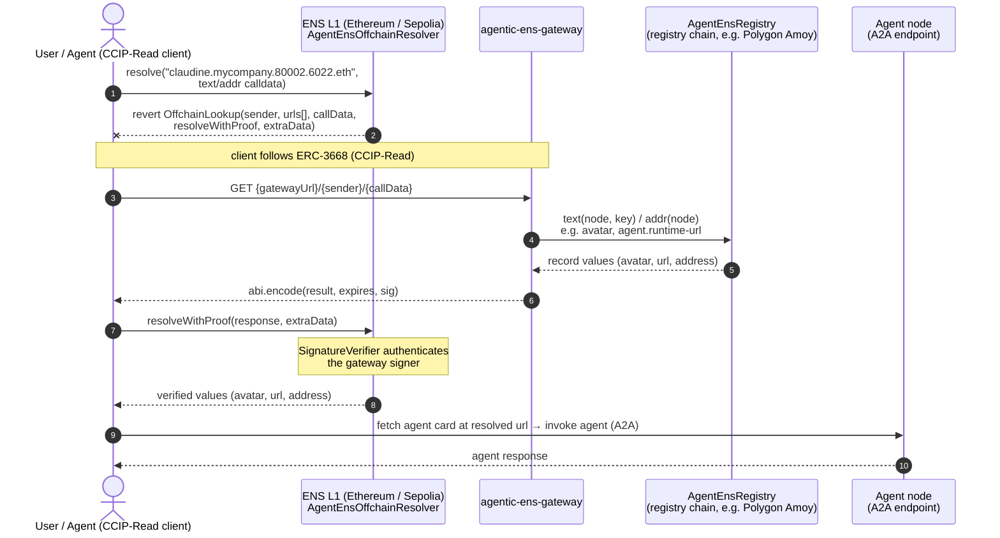

# Agentic ENS Gateway

[](https://github.com/6022-labs/agentic-ens-gateway/actions/workflows/go-build.yml)
[](https://github.com/6022-labs/agentic-ens-gateway/actions/workflows/go-unit-tests.yml)
[](https://github.com/6022-labs/agentic-ens-gateway/actions/workflows/go-lint.yml)
[](LICENSE)

A CCIP-Read (ERC-3668) gateway that lets ENS on Ethereum answer questions about
agents whose records live on another chain.

An agent's records — its address, avatar, `agent.runtime-url` — are written to an
`AgentEnsRegistry` contract on the chain its collection was deployed to, which is
rarely Ethereum. ENS resolution, however, starts on Ethereum. The
`AgentEnsOffchainResolver` there bridges the gap by reverting with
`OffchainLookup`, which sends the client here. This gateway reads the record from
the right chain, signs the answer, and the L1 resolver verifies that signature
before handing the value back. The client gets a normal ENS lookup; the data
never had to be on Ethereum.

Part of the [6022 agentic ecosystem](https://docs.agentic.6022.io) — the contracts
live in [`agentic-smart-contracts`](https://github.com/6022-labs/agentic-smart-contracts).

Go, Fiber, `go.uber.org/dig`, `koanf`, Redis.

## Resolution flow

An agent's name is `<agent>.<collection>.<chainId>.6022.eth`. The chain id label
is what tells the gateway which registry holds the records — `80002` is Polygon
Amoy, `137` Polygon mainnet. The client never talks to that chain itself.



Step 4 is the whole job: decode `IResolverService.resolve(bytes name, bytes data)`,
take the chain id from the DNS-encoded name and the `text` / `addr` query from the
calldata, read the record (through a Redis cache), sign it. If the registry has no
record for that node, the gateway falls back to canonical ENS — see below.

## Layout

- `src/ens_gateway` — core domain (codec, signer, response builder, use case).
- `src/ens_gateway_blockchain` — per-chain RPC clients + `AgentEnsRegistry` reader.
- `src/ens_gateway_mvc` — Fiber controllers (CCIP-Read endpoint + health).
- `src/ens_gateway_redis` — resolution cache backend.
- `src/ens_gateway_host` — HTTP host entrypoint, DI wiring, server config.
- `src/common` — telemetry bootstrap, shared metrics and middlewares.
- `grafana/` — the observability stack (Alloy, Mimir, Loki, Tempo, dashboards).

The HTTP API is documented in `src/ens_gateway_host/docs/` (`make swagger` regenerates it).

## Run

```sh
cp src/ens_gateway_host/appsettings.example.json src/ens_gateway_host/appsettings.json
# fill chains.<chain_id>.rpc_http_url and signed_response.private_key
cd src/ens_gateway_host && go run .
```

Or bring up the gateway plus Redis and the observability stack:

```sh
docker compose up
```

- **Gateway:** http://localhost:5000
- **Grafana:** http://localhost:3000

## Configuration

Every setting is reachable from `appsettings.json` or from the environment —
double underscores map to the JSON nesting (`REDIS__HOST` is `redis.host`). See
`src/ens_gateway_host/.env.example`, which documents each one.

The one that matters most is `SIGNED_RESPONSE__PRIVATE_KEY`: the ECDSA key the
gateway signs with. Its address must be in the L1 resolver's `signers` set, or
every answer is rejected on-chain. Never commit it.

Registry addresses are not operator config — they are baked into the build in
`src/ens_gateway_blockchain/settings/agent_ens_registries.json`. A chain listed
there without a configured RPC URL is skipped.

## ENS fallback

When the registry has no record for a node, the gateway falls back to the
canonical ENS `UniversalResolver`. Each source chain routes to its own resolver
chain — mainnet sources to Ethereum, testnet sources to Sepolia — and may route
to itself, in which case the fallback is plain ENS resolution on that chain.

That routing table lives in
`src/ens_gateway_blockchain/settings/universal_resolvers.json`: a new source chain
is one line, a new resolver deployment is one line. Set the resolver chain's
`chains.<chain_id>.rpc_http_url` to turn it on; omit it and the fallback is off
for every source chain mapped to it.

A fallback that reverts — including the `OffchainLookup` of a resolver that is
itself CCIP-Read — or an unreachable RPC logs a warning and returns the original
empty result. Clients never see a 5xx from a failed fallback.

## Observability

The host exports metrics, logs and traces over OTLP to Grafana Alloy, which
fans them out to Mimir, Loki and Tempo. Several apps and environments can share
one stack — `service.name`, `service.instance.id` and
`deployment.environment.name` tell them apart, and every dashboard filters on
them. `TELEMETRY__*` configures the export side; see `.env.example`.
`TELEMETRY__PROTOCOL` picks `grpc` (default, port 4317) or `http` (port 4318) for
hosts whose route to Alloy only carries plain HTTPS.

`grafana/dashboards/ens-gateway.json` covers resolution rate and latency by
source, cache hit ratio, L1 fallback outcomes, decode errors and signing failures.

Alloy's OTLP ingest is **unauthenticated by default** and says so at startup.
`OTLP_AUTH_HTPASSWD` / `OTLP_AUTH_TOKEN` turn authentication on, `OTLP_TLS_*`
serves it over TLS — pair them on any untrusted network.

## Development

```sh
make build   # go build ./src/...
make test    # unit tests
make lint    # golangci-lint v2
make mocks   # regenerate gomock mocks after an interface change
make swagger # regenerate the host API docs
make hooks   # git hooks: format + secret scan on commit, build/lint/test on push
```

Redis integration tests live in `tests/ens_gateway_redis_integration_tests/`, spin
a real container, and stay out of `make test`. They need Docker.

## License

MIT — see [LICENSE](LICENSE).
