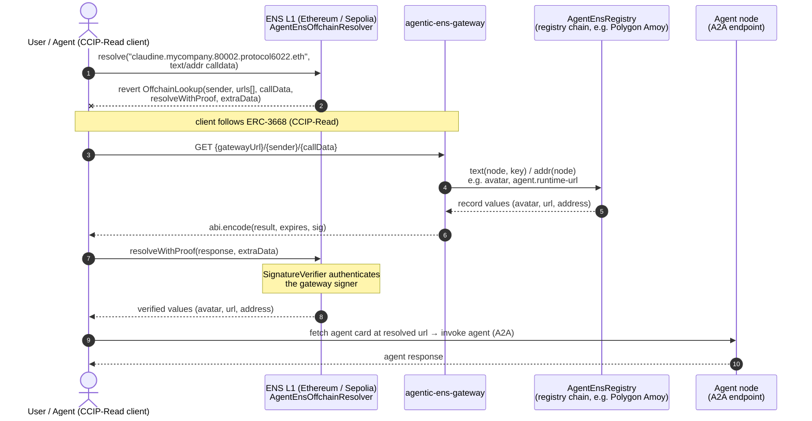

# agentic-ens-gateway

ERC-3668 / CCIP-Read gateway for agent ENS records.

Agent text records (`agent.runtime-url`, `agent.runtime-kind`) are stored
on-chain in `AgentEnsRegistry` contracts on one or more EVM chains. On Ethereum
L1, the `AgentEnsOffchainResolver` contract reverts with `OffchainLookup` per
ERC-3668, and a CCIP-Read client calls this gateway. The gateway:

1. Decodes the resolver's `IResolverService.resolve(bytes name, bytes data)`
   call data, extracts the chain id from a fixed label of the DNS-encoded
   name, then decodes the inner `text(bytes32 node, string key)` query.
2. Reads `AgentEnsRegistry.text(node, key)` on the matching chain.
3. Returns an ENS-format **signed** response — `abi.encode(result, expires,
   sig)` — that the L1 resolver's `SignatureVerifier` authenticates.

Architecture mirrors `agentic-agent-node` (hexagonal modules, `go.uber.org/dig`
DI, `koanf` config, Fiber host, `when_*_test.go` tests).

## Resolution flow

End-to-end path from an agent's ENS name —
`<agent>.<collection>.<chainId>.protocol6022.eth` — to invoking the agent
itself. The chain id label tells the gateway which chain's registry holds
the records (`80002` = Polygon Amoy, `137` = Polygon mainnet). The
client never talks to the registry chain directly — the `OffchainLookup`
revert on L1 redirects it to this gateway, which reads the records cross-chain
and signs them so L1 can verify the answer.



If the registry has no record for the node, step 4 falls back to the canonical
ENS `UniversalResolver` — see [ENS fallback](#ens-fallback-optional) below.

## Layout

- `src/ens_gateway` — core domain (codec, signer, response builder, use case).
- `src/ens_gateway_blockchain` — per-chain RPC clients + `AgentEnsRegistry` reader.
- `src/ens_gateway_mvc` — Fiber controllers (CCIP-Read endpoint + health).
- `src/ens_gateway_host` — HTTP host entrypoint, DI wiring, server config.

## Run

```sh
cp src/ens_gateway_host/appsettings.example.json src/ens_gateway_host/appsettings.json
# fill chains.<chain_id>.rpc_http_url and signed_response.private_key
cd src/ens_gateway_host && go run .
```

## ENS fallback (optional)

When the per-chain `AgentEnsRegistry` has no record for a node, the gateway
can fall back to the canonical ENS `UniversalResolver` on a chain where one is
deployed. Each source chain routes to its own resolver chain — mainnet sources
fall back to Ethereum mainnet, testnet sources fall back to Sepolia. A chain
can route to itself (e.g. chain 1 → chain 1), in which case the fallback just
follows the standard ENS resolution path on that chain.

**Routing table.** The mapping and the UniversalResolver address per chain are
baked into `src/ens_gateway_blockchain/settings/universal_resolvers.json`:

```json
{
  "resolvers": [
    { "chainId": 1,        "address": "0xeEeEEEeE14D718C2B47D9923Deab1335E144EeEe" },
    { "chainId": 11155111, "address": "0xeEeEEEeE14D718C2B47D9923Deab1335E144EeEe" }
  ],
  "mappings": [
    { "sourceChainId": 1,     "universalResolverChainId": 1 },
    { "sourceChainId": 137,   "universalResolverChainId": 1 },
    { "sourceChainId": 80002, "universalResolverChainId": 11155111 }
  ]
}
```

Adding a new source chain = one line in `mappings`. Adding a new resolver
deployment = one line in `resolvers`. An empty `address` disables fallback for
any source chain mapped to that resolver chain.

**Enabling at runtime.** For each resolver chain listed in `resolvers` with an
address, configure the RPC URL in `chains.<universalResolverChainId>.rpc_http_url`:

```json
"chains": {
  "137":      { "rpc_http_url": "https://polygon-rpc.example" },
  "80002":    { "rpc_http_url": "https://amoy-rpc.example" },
  "1":        { "rpc_http_url": "https://mainnet-rpc.example" },
  "11155111": { "rpc_http_url": "https://sepolia-rpc.example" }
}
```

or via env var, e.g. `CHAINS__1__RPC_HTTP_URL=…`. Omit a resolver chain's
entry to disable the fallback for every source chain mapped to it.

**Failure behavior.** If the resolver call reverts (e.g. the underlying
resolver itself uses CCIP-Read and raises `OffchainLookup`) or the RPC is
unreachable, the gateway logs at `warn` and returns the original empty result
— clients never see a 5xx from a fallback failure.

**Note.** Resolver chains present in `chains` only for fallback do not need an
entry in `agent_ens_registries.json`. The registry reader iterates the
registries file, so fallback-only chains are ignored by the registry lookup.
